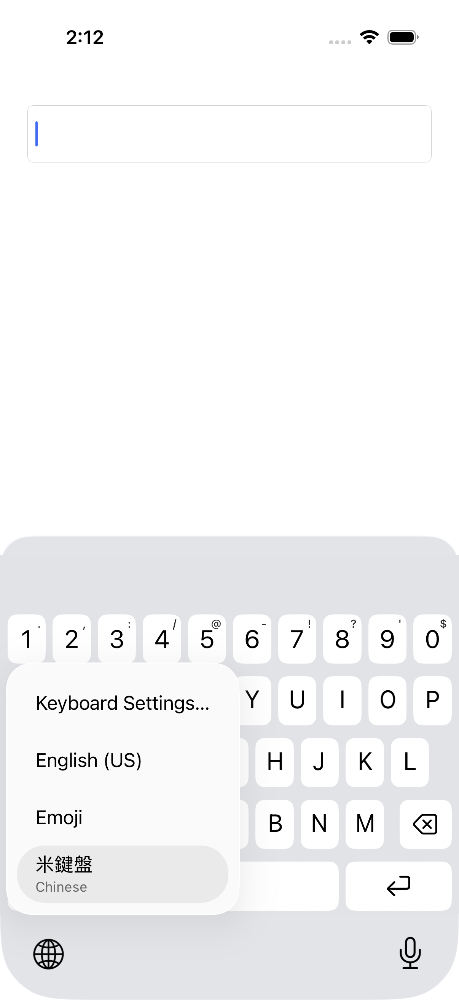

# Real three-keyboard switching

The `KeyboardSwitchHost` app contains an autofocus native `UITextField` with autocorrection off. Its separate UI-test target is built in Release for measurement and is never embedded in the shipping app/archive. This isolates keyboard switching from the main app’s scrolling SwiftUI practice editor.

The integration tests require exactly three real system-enabled keyboards on an English-language iPhone simulator: English (US), Emoji, and 米鍵盤. Use a dedicated simulator so personal keyboard settings are preserved. Install the app, enable those keyboards in Settings, remove other keyboards, and disconnect the simulator hardware keyboard. Full Access stays off.

```sh
xcodebuild -project Boshiamy.xcodeproj -scheme Boshiamy \
  -configuration Release -destination 'platform=iOS Simulator,id=<UDID>' \
  -parallel-testing-enabled NO -resultBundlePath build/SwitchLatency.xcresult \
  -only-testing:KeyboardSwitchUITests/KeyboardSwitchUITests/testThreeKeyboardsPickerAndCompositionCancellation \
  -only-testing:KeyboardSwitchUITests/KeyboardSwitchUITests/testThreeKeyboardsSwitchLatency test
xcrun xcresulttool export attachments --path build/SwitchLatency.xcresult \
  --output-path build/SwitchLatencyAttachments
```

Use the system-provided globe to open the persistent picker for setup and controlled selections. The embedded globe is measured separately with short taps; its long-press/release menu lifetime is not assumed.

The test fails if the enabled-keyboard roster differs. It also verifies the real system picker exposes all three keyboards, switches to each native keyboard, checks native English input, and verifies switching cancels pending Chinese composition without inserting text. Native-to-native selections are controls.

The latency test records five samples for each of the six directed picker-selection routes, plus ten short taps on the embedded globe after establishing English and Emoji separately as the previous native keyboard. Short taps accept and record the actual system-selected destination instead of assuming English. A target must become accessible and hittable within five seconds after the action returns. Failures/timeouts must not be summarized as successful measurements.

`keyboard-switch-latency` is a retained JSON attachment in the result bundle. `actionMilliseconds` measures the XCTest action call; `readyMilliseconds` runs from before that action until the destination's identifying key becomes accessible and hittable. Both use monotonic `systemUptime`. Readiness is checked immediately and retried with a 20 ms delay plus accessibility-query time, avoiding a coarse predicate-expectation timer. Picker selection starts after opening the picker, so it excludes the deliberate 1.2-second hold, menu-opening time and human selection time. The JSON retains each sample and route, including the previous native keyboard for short taps.

These are automation-observed Simulator timings. They include XCTest event injection, idle synchronization and accessibility polling; they are **not physical touch-to-display latency** or an isolated measurement of the extension's CPU time. All three keyboards are warmed before recording these series; one-time system keyboard tutorials are dismissed outside measurement. Five samples per picker route give descriptive median and nearest-rank p95 (the maximum for n=5), not a stable tail estimate. No cold-start claim is made. Compare only like gestures/routes on the same test environment; a short tap and picker selection are separate series. The existing fixed-build-5 guard covers synchronous engine/rendering work and does not substitute for these system-switch measurements.

## First observed activation

`testThreeKeyboardsFirstActivationLatency` records one English→米鍵盤 picker selection and checks A + Space → 對. Run it separately after verifying that the extension process on the dedicated simulator has exited; retain that process-preparation evidence beside the result bundle. The test itself does not assert that the OS or filesystem caches are cold. This is a single observation, with no median/p95 claim.

## Exploratory host failures

Earlier probes in the main app's scrolling SwiftUI `TextEditor` encountered UIKit `UIKeyboardTaskQueue` waits exceeding 60 seconds, including a native Zhuyin→English control. Those probes also exposed unsuitable picker selectors and first-use system UI. They are retained as diagnostic evidence and are not valid steady-state switch samples or proof that 米鍵盤 caused the wait. This test host isolates real keyboard switching; it does not establish that the original editor hang or a physical-device delay has been fixed.

## 1.0 (20) observed results

Release, iPhone 17 Pro / iOS 26.5 Simulator, English (US) + Emoji + 米鍵盤. All three new integration cases passed.

| Operation | n | Median ms | p95 ms | Median action-call ms |
| --- | ---: | ---: | ---: | ---: |
| english → emoji (pickerSelection) | 5 | 484.6 | 509.4 | 334.6 |
| emoji → english (pickerSelection) | 5 | 442.4 | 458.2 | 383.3 |
| english → mi (pickerSelection) | 5 | 436.9 | 439.8 | 334.6 |
| mi → english (pickerSelection) | 5 | 455.7 | 458.1 | 386.8 |
| emoji → mi (pickerSelection) | 5 | 470.0 | 483.5 | 374.6 |
| mi → emoji (pickerSelection) | 5 | 529.3 | 533.3 | 384.6 |
| mi → english (shortTap, previous=english) | 5 | 467.9 | 471.8 | 398.6 |
| mi → english (shortTap, previous=emoji) | 5 | 458.7 | 459.6 | 389.0 |

First observed English→米鍵盤 activation after the extension process was absent: **1052.5 ms**, including an action call of 336.2 ms. This is one observation; OS caches were not flushed.

The two previous-native histories both selected English in this run. This does not guarantee that iOS will choose English with other keyboard lists or histories. The measurements do not establish the cause of a physical-device slowdown.

[All 41 raw observations and summary](switch-latency-1.0-build20.json).


