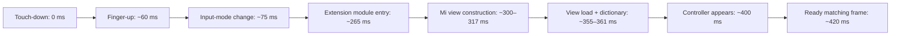

# Full keyboard-switch profile: 1.0 (23)

**The dominant measured delay is fresh iOS extension-process activation. No meaningful app-side full-switch speedup was found or merged.** The shipping keyboard/engine/resource source matches build 22; build 23 adds a reproducible profiler, regression detection and evidence. Native English and the system picker are retained. The cold 200 ms goal remains unmet.

## Actual path, outside XCTest

Dedicated iPhone 17 Pro / iOS 26.5 Simulator, exactly English (US), Emoji and 米鍵盤; Full Access off. These are real keyboards and a native UITextField host. The headless input utility sends actual Simulator HID touches. XCTest is absent from the timing run. The profiler does not disable accessibility or change the enabled keyboard list.

| Touch-down to controller-ready matching recorded frame | Count | Median | p95 |
| --- | ---: | ---: | ---: |
| Mi → native English | 10 | 107.5 ms | 117.6 ms |
| Native English → Mi, process retained | 5 | 166.8 ms | 172.7 ms |
| Native English → Mi, fresh process | 5 | 422.7 ms | 428.7 ms |

Every cold sample explicitly terminates only the dedicated Simulator's **inactive** Mi extension after native English is verified. A different PID and a new native module-constructor event must appear on the next activation. OS/filesystem caches are not asserted cold. Natural process eviction was not reproduced in these warm loops; forced fresh-process results quantify its cost rather than prove the cause of a particular user's slow switch.

The clock is rendered in the host and decoded from recorded frames, aligned to monotonic touch timestamps. Precision is approximately one display frame (16.7 ms). A frame must match the settled destination letter rows **and** follow the destination controller's readiness callback. A cached Mi snapshot can appear around 100 ms while its new controller is still starting; counting that snapshot would hide the delay. These are Simulator measurements, not physical display measurements.

A representative unsampled fresh-process trace is:



The app-owned construction and dictionary work occupy roughly 20 ms in this trace. Process startup and UIKit/controller lifecycle occur around it. A separate startup stack sample found UIKit accessibility initialization and dynamic framework loading before our controller when XCTest was active. Sampling itself perturbs launch time, so sampled timings are excluded from the table. The older ~450 ms warm outgoing metric included XCTest event injection, idle waiting and accessibility queries; it was not an isolated native transition time.

## Changes tested and rejected

| Experiment | Result | Decision |
| --- | --- | --- |
| Direct public `advanceToNextInputMode()` for short tap | Exploratory median ~112 vs ~113 ms, below frame precision | Keep the complete system gesture handler |
| Defer keyboard view construction until view loading | Standalone cold median 416 vs 419 ms; warm 164 vs 160 ms (3 incoming samples each) | No meaningful full-path gain; revert |
| Minimal linked UIKit extension, engine/dictionary/key layout removed | Cold median 384 ms, p95 403 ms (3 samples) | Lower-bound control only; never shipped |

Even the deliberately nonfunctional minimal controller retains most of the cold delay. The tested app changes do not address its dominant part. This is a measured limit of this Simulator setup, not a claim that every iOS version/device has the same floor.

The production path still uses Apple's [handleInputModeList(from:with:)](https://developer.apple.com/documentation/uikit/uiinputviewcontroller/handleinputmodelist(from:with:)), preserving tap, long press and swipe-up interaction. The [next-keyboard API](https://developer.apple.com/documentation/uikit/uiinputviewcontroller/advancetonextinputmode()) lets iOS pick the next enabled keyboard; the profiler explicitly establishes and verifies the native English route.

## Reproduce and guard the complete path

Requires Xcode, XcodeGen, Python with NumPy, and ffmpeg/ffprobe. Use a **dedicated**, booted portrait iPhone 17 Pro / iOS 26.5 Simulator named `Mi Keyboard Switch Latency`, with exactly English (US), Emoji and 米鍵盤 enabled and the hardware keyboard disconnected.

```sh
python3 scripts/profile_keyboard_switching.py   --simulator <UDID> --output build/switch-profile   --warm-iterations 5 --cold-iterations 5
```

The runner freezes the product source, builds an unmodified restoration app and an isolated instrumented copy, and uses a separate native host. It verifies native `q` insertion, HX → 愛, deletion, pending-composition cancellation, all three real picker entries, the embedded globe's long press and actual native Emoji appearance. No mock input proxy is used. Private macOS SimulatorKit HID interfaces are confined to the test utility; the shipping iOS app uses public APIs.

The **non-regression envelopes** are 200 ms p95 for warm routes and 450 ms p95 for fresh-process activation. The separate cold **target** remains 200 ms and is reported as `NOT MET`; passing the envelope does not mean achieving that target. Missing switches, stale PIDs, missing/invalid clocks, incorrect output or failed app restoration fail the run.

A negative control must fail the warm budget:

```sh
python3 scripts/profile_keyboard_switching.py   --simulator <UDID> --output build/switch-negative   --warm-iterations 1 --cold-iterations 0 --inject-exit-delay-ms 250
```

The delay exists only in the generated profiling copy. The original app is restored and its installed extension binary checksum checked even after failure. `--minimum-control` similarly creates an explicitly nonfunctional lower-bound copy. Artifacts include raw events, actions, video, picker screenshots, source hashes and `results.json`; output directories must be fresh. Timing and sampling runs should remain separate.

[All samples and experiments](switch-profile-1.0-build23.json) · [Shipping source hashes](source-1.0-build23.json) · [Existing build 5 performance gate](PERFORMANCE.md). The permanent build 5 manifest/comparator and its seven workload thresholds are unchanged.

## Release verification

42 Release unit tests and the ten immutable-build-5 correctness/rendering/performance checks passed for build 23 with no failures or skips. All seven paired median/p95 workload ratios remain <= 1.05. The new full-path run passed its declared non-regression envelopes, verified all functional outputs and restored the unmodified extension binary. The 250 ms negative control failed with a 366.7 ms outgoing ready frame while functional checks and restoration still passed. Existing build 22 native UI evidence retains its original scope; the previous full main-App/iPad suites were not rerun for unchanged shipping source.
