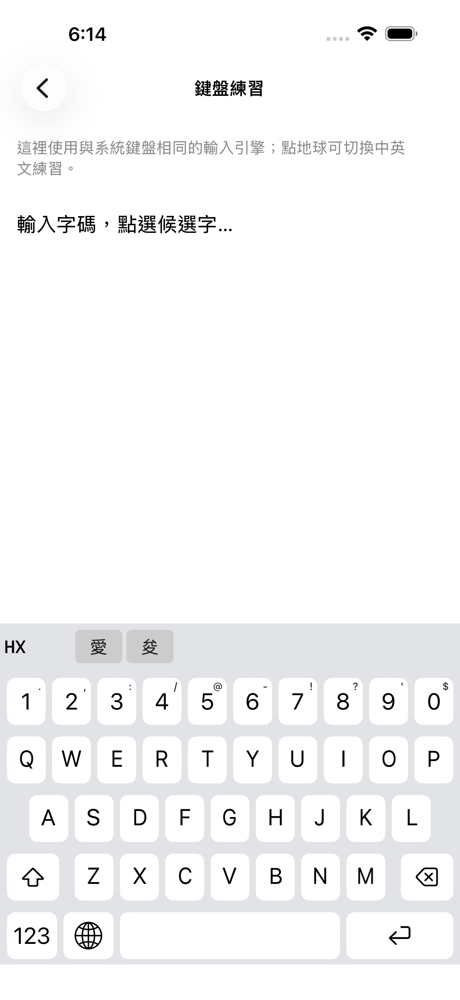

# 米鍵盤 — 免費、開源、離線的 iOS 字碼鍵盤

米鍵盤是一款支援繁體中文與英文的原生 iOS 鍵盤，提供嘸蝦米相容字碼輸入。適用於 iOS 17 以上的 iPhone 與 iPad。

## 三個賣點

- **開源透明**：App 與 Swift 輸入引擎採 [MIT License](LICENSE)，原始碼可檢視、修改與分享；字碼表來源與轉換工具一併公開。
- **字碼表自由使用**：採用 Fcitx5 上游宣告為 public domain 的社群字碼資料，自行實作輸入引擎，不依賴商用字表或官方引擎。第三方資料仍依各自授權使用，詳見 [授權與來源](THIRD-PARTY-NOTICES.md)。
- **完全免費**：無訂閱、無廣告、沒有付費解鎖。

所有輸入處理都在裝置上完成，不記錄或上傳輸入內容，也不要求「允許完整取用」。字碼表隨 App 提供與更新，不需要匯入或管理外部檔案。

[使用說明與支援](https://theonlyperson.com/mi-keyboard) · [隱私權政策](https://theonlyperson.com/mi-keyboard#privacy)



## 功能

- 常駐數字列、QWERTY 字母排列、水平滑動候選列。
- 點選候選、空白選第一字，或中文組字時以 1–9 選對應候選。
- 離線同音查詢：中文長按 9（'），輸入已知同音字的字碼，選查詢字後再選同音字。
- 英文三態 Shift：小寫、下一字母大寫、雙擊鎖定大寫。
- 兩頁符號、長按數字輸入標點、長按刪除、立即字元預覽。
- 地球鍵切換 iOS 系統鍵盤，長按叫出系統鍵盤選單；App 內練習以地球切換中英文。
- 安裝指引、App 內練習與離線隱私權說明。

內建字表含 30,916 組字碼、39,694 個字碼候選對、19,680 種文字／符號。

## 自行建置

需要 macOS、Xcode 與 XcodeGen；已在 Xcode 26／iOS 26.5 Simulator 驗證。沒有第三方 runtime 套件相依。

```sh
git clone https://github.com/huang47/mi-keyboard.git
cd mi-keyboard
xcodegen generate
xcodebuild -project Boshiamy.xcodeproj -scheme Boshiamy \
  -configuration Debug -sdk iphonesimulator \
  -derivedDataPath build CODE_SIGNING_ALLOWED=NO build
```

安裝至自己的 iPhone：在 Xcode 將主 App 與 `BoshiamyKeyboard` 設為自己的 Developer Team，改成唯一的 bundle ID，連接手機後 Run。兩者不需要 App Group。

安裝後至「設定 → 一般 → 鍵盤 → 鍵盤 → 加入新鍵盤 → 米鍵盤」。打字時長按地球切換；不需開啟完整取用。試打 `A`＋空白 →「對」、`HX`＋空白 →「愛」。

## 測試與效能

1.0（19）只修改版本／build metadata，功能與 build 18 相同。39 項 Release、10 項固定基準檢查重跑通過；27 項 iPhone UI 與 3 項 iPad UI 沿用相同產品來源的 build 18 證據。

- [測試與覆蓋範圍](Documentation/TESTING.md)
- [固定 build 5 效能門檻](Documentation/PERFORMANCE.md)
- [鍵盤結構](Documentation/ARCHITECTURE.md)
- [1.0 產品來源 checksum](Documentation/source-1.0.json)

## 字表更新與來源

字碼表固定從 App／鍵盤各自的 bundle 載入，更新 App 即可更新字表。開發者可離線重建：

```sh
python3 scripts/prepare_table.py
python3 scripts/prepare_homophones.py
```

[Fcitx5 字碼資料與聲明](ThirdParty/Fcitx5/NOTICE.md)、[Unicode 同音資料與聲明](ThirdParty/Unicode/NOTICE.md) 均保留固定來源版本與 checksum。

## 限制與授權

米鍵盤為獨立開發工具，非行易官方產品，與行易無隸屬、合作或背書關係。「嘸蝦米／Boshiamy」僅用於說明字碼相容性，相關商標屬於各自權利人；本專案未提供所有官方指令或字碼功能。沒有快打自動上字、萬用碼、聯想詞或字頻學習。密碼、電話欄位及禁止第三方鍵盤的 App 可能由 iOS 改用系統鍵盤。

自寫程式碼採 [MIT License](LICENSE)。第三方字碼表、Unicode 資料及其聲明保留原授權；MIT 不會取代這些資料的授權條款。相關商標屬於各自權利人。
